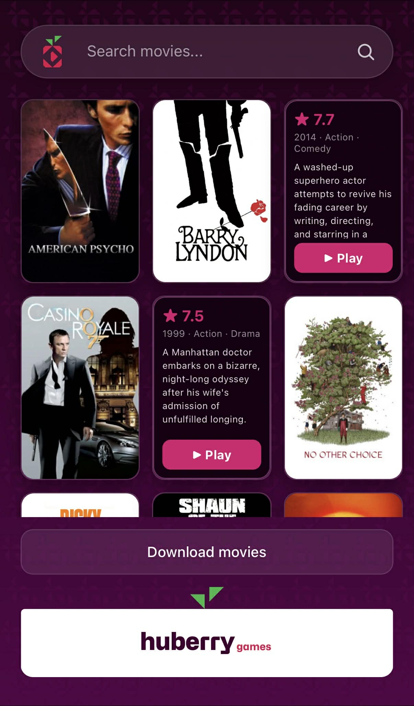
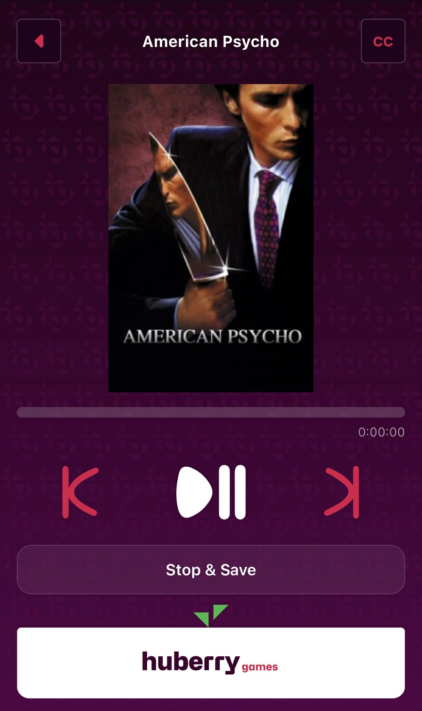
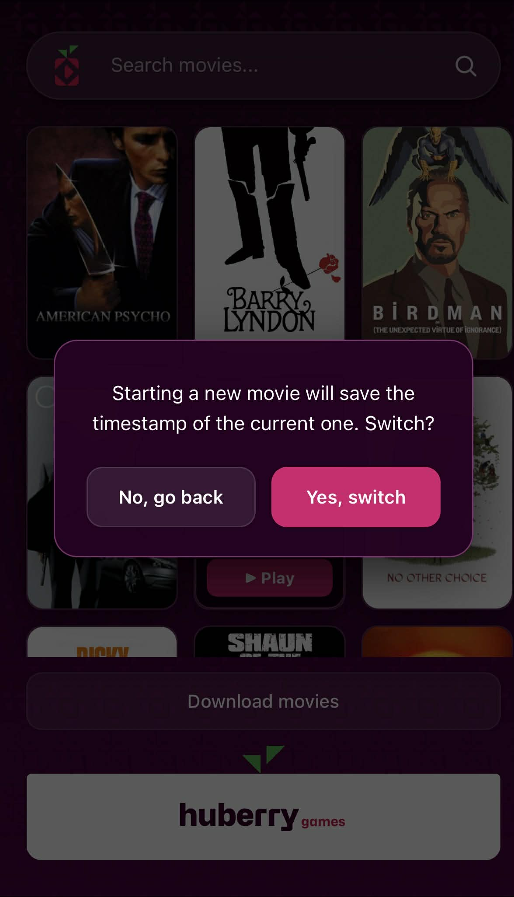

# Huberry Stream

A phone-controlled movie player built around MPV. A C++ process runs MPV as a bare window with an IPC socket exposed, and a Flask webserver lets you control it from any browser on the same network — use your phone as a remote, or stream directly to it.

Built to run on a Raspberry Pi 5 (or any Linux machine) as part of a larger retro-gaming Linux setup, but also works standalone on Windows during development.

<p align="center"></p>

---

## Installation

### Linux (Raspberry Pi / desktop)

**1. Install system dependencies**

```bash
sudo apt install python3-pip python3-venv mpv
```

MPV is only required for the **Play on TV** mode. Skip it if you only need phone streaming.

**2. Create the movies directory**

```bash
mkdir -p ~/movies
```

**3. Set up the Python environment**

```bash
cd ~/webserver-videoplayer/python-remote
python3 -m venv venv
source venv/bin/activate
pip install -r requirements-linux.txt
```

> If `pip install libtorrent` fails, install it via apt instead:
> ```bash
> sudo apt install python3-libtorrent
> pip install Flask requests
> ```

**4. Start the server**

```bash
python3 remote.py
```

Open your phone browser (on the same Wi-Fi) to `http://<your-ip>:5000`. Find your IP with `ip a`.

**5. Build the C++ player** *(optional - only needed for Play on TV)*

```bash
sudo apt install cmake libmpv-dev
pip install conan
bash buildPlayer.sh
```

The binary lands at `build/wserVideoPlayer` and is launched automatically by the server when needed.

---

### Windows (development)

**1. Build the C++ player**

Place the MPV `.dll` files into a `deps/` folder in the project root, then run:

```
.\buildAndRun.ps1
```

**2. Start the Flask server**

```
/venv/scripts/Activate.ps1
python remote.py
```

Install dependencies first if needed: `pip install -r requirements.txt`

---

## Movie library

Each movie lives in its own subfolder inside `~/movies/` (Linux) or `movies/` at the project root (Windows).

```
movies/
├── Inception/
│   ├── inception.mp4
│   ├── poster.jpg
│   └── Inception.en.srt
└── Dune/
    ├── dune.mkv
    └── poster.jpg
```

- **Title** — taken automatically from the folder name
- **Poster** — any `.jpg` file found inside the folder is used as the gallery thumbnail
- **Subtitles** - `.srt` files in the folder are picked up automatically in both modes. In remote mode they appear in the CC menu; when streaming to phone they are converted to WebVTT on-the-fly and loaded as selectable tracks in the browser's native video player
---

## Features

<p align="center">  </p>

**Gallery**: Searchable 3-column movie grid. Tap any poster to flip it and see rating, genre, and synopsis fetched from YTS, then choose how to watch.

**Play on TV**: Launches the movie in MPV on the host machine's display and turns your phone into a remote:
- Play / Pause
- Skip ±10 seconds
- Tap anywhere on the progress bar to seek to that position
- Toggle subtitles (CC)
- Stop & Save: stops playback and saves your position

**Stream to phone**: Streams the video file directly to your phone browser over HTTP. No transcoding — the file is served as-is with range request support so seeking works instantly. Subtitles are converted from `.srt` to WebVTT on-the-fly and appear as selectable tracks in the native video player.

> MP4 streams on all devices. MKV streams on Android/Chrome and Firefox but not iOS Safari.

**Resume**: Both modes share the same resume positions. Whichever way you watched last, picking up where you left off works the same.

**Movie switching**: tapping a card while something is already playing has three behaviours:
1. Same movie → jumps to the remote view instantly, no reload
2. Different movie → a confirmation dialog appears before switching, and your current position is saved automatically
3. Nothing playing → loads immediately

**Download**: Search YTS directly from the app and start a torrent download in the background. The movie appears in the gallery automatically when complete.

---

## Legal disclaimer

This software is intended strictly for personal, educational, and non-commercial use.

- Any movie titles, images, or posters shown in screenshots or documentation are used for demonstration purposes only. All rights belong to their respective owners.
- Users are responsible for ensuring they have the legal right to play any content loaded into the movies directory.
- The author is not responsible for any misuse of this software or legal issues arising from use of copyrighted material.